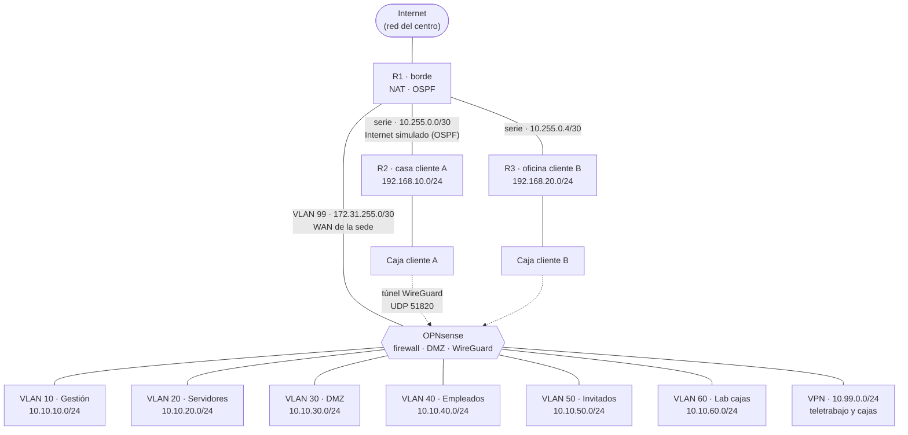
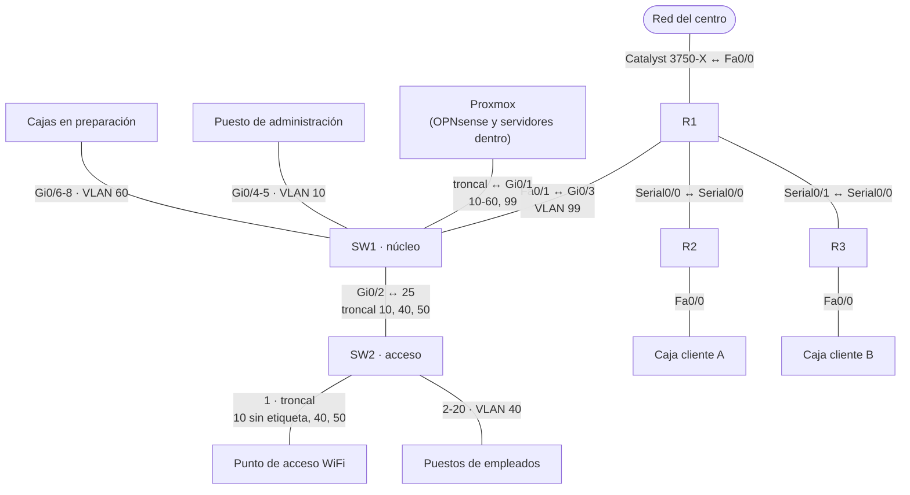

# Diseño de red de la sede NoSub

Este documento tiene el **plano lógico** (redes, direcciones y quién habla con quién) y el **plano físico** (qué cable va a qué puerto).
Los datos salen del repositorio: `inventories/sede/group_vars/all/main.yml` (VLANs) y `red_fisica.yml` (equipos de red).
Si se cambia algo allí, hay que actualizar también este documento.

## 1. Idea general

- **OPNsense** es el centro de la sede: separa las 6 VLANs, decide quién puede hablar con quién y recibe la VPN (WireGuard).
- **R1** es la salida a Internet de la sede (a través de la red del centro).
- **R2 y R3 son dos clientes**: la casa del cliente A y la oficina del cliente B. R1 está unido a cada uno por un **enlace serie**: es el "Internet" simulado, con OSPF. Así las cajas se prueban como en una instalación real: el cliente tiene su router con NAT y la caja abre el túnel hacia la sede.
- **SW1** (núcleo) une Proxmox, R1 y SW2. **SW2** (acceso) da red a los puestos de empleados y al punto de acceso WiFi.
- Los servidores son **virtuales** (contenedores en Proxmox): no ocupan puertos de los switches. Todas sus VLANs llegan a Proxmox por un único cable troncal.

## 2. Plano lógico

### Redes

| VLAN | Nombre | Red | Puerta | Qué hay | Puede ir a |
|---|---|---|---|---|---|
| 10 | Gestión | 10.10.10.0/24 | .1 | Proxmox, switches, AP, puesto de administración | Todo |
| 20 | Servidores | 10.10.20.0/24 | .1 | Gitea, DNS, DHCP, BBDD, monitorización | Todo menos gestión y la administración del firewall |
| 30 | DMZ | 10.10.30.0/24 | .1 | Traefik, extranet, k3s | Solo Internet |
| 40 | Empleados | 10.10.40.0/24 | .1 | Puestos y WiFi de empleados | Servidores, DMZ e Internet |
| 50 | Invitados | 10.10.50.0/24 | .1 | WiFi de invitados | Solo Internet |
| 60 | Lab cajas | 10.10.60.0/24 | .1 | Cajas que se preparan antes de entregarlas | Servidores e Internet |
| — | VPN | 10.99.0.0/24 | .1 | Teletrabajo (.2-.127) y cajas de los clientes (10.99.0.128/25) | Teletrabajo: servidores y DMZ (no la administración del firewall). Cajas: nada; solo entran en ellas el nodo de control (SSH) y el monitor (métricas) |
| 99 | Enlace R1 | 172.31.255.0/30 | — | WAN de OPNsense (.2) y R1 (.1) | Fuera del firewall |
| 999 | Aparcado | — | — | Nada: puertos sin uso y VLAN nativa de los troncales | — |

La VLAN 99 está **fuera del firewall**. Solo pasa por SW1, entre Proxmox y R1, y nunca llega a SW2.

**Enlaces serie ("Internet" simulado, fuera del firewall):** salen de la red 10.255.0.0/24.

| Enlace | Red | R1 | Cliente |
|---|---|---|---|
| R1 Serial0/0 ↔ R2 Serial0/0 | 10.255.0.0/30 | .1 (pone el reloj, DCE) | .2 |
| R1 Serial0/1 ↔ R3 Serial0/0 | 10.255.0.4/30 | .5 (pone el reloj, DCE) | .6 |

### Direcciones fijas en gestión (VLAN 10)

| Equipo | IP |
|---|---|
| OPNsense | 10.10.10.1 |
| Proxmox | 10.10.10.2 |
| SW1 | 10.10.10.3 |
| SW2 | 10.10.10.4 |
| Punto de acceso | 10.10.10.5 |
| GNS3 (fase 4) | 10.10.10.20 |

Los routers no están en gestión: están fuera del firewall. Se administran por SSH desde la sede. Ese tráfico les llega desde la WAN de OPNsense (172.31.255.2), y es la única dirección que aceptan.

### Cómo circula el tráfico

- **Salida a Internet de la sede:** VLAN → OPNsense (NAT) → R1 (NAT otra vez) → red del centro. R1 no necesita conocer las redes 10.10.x.x.
- **Rutas entre routers (OSPF, área 0):** R1 anuncia a R2 y R3 la ruta por defecto y la red de la WAN de la sede (172.31.255.0/30). Las redes de los clientes no se anuncian: están detrás de NAT, como en una casa de verdad.
- **Una caja en casa del cliente:** recibe IP del router del cliente (R2 o R3, por DHCP) y abre el túnel WireGuard hacia 172.31.255.2:51820. En la sede de verdad sería la IP pública.
- **La VPN desde fuera del centro:** el centro reenvía un puerto UDP de su IP pública (compartida por todos los grupos) a R1, y R1 lo reenvía a la WAN de OPNsense (172.31.255.2:51820; dato `reenvios` de R1). Si el centro no puede, la VPN entra por el VPS del cloud.
- **DHCP de la sede:** lo da Kea (CT `red-int`, 10.10.20.11). OPNsense hace de *relay* en gestión, empleados, invitados y lab cajas, y reparte de la .100 a la .199. Servidores y DMZ llevan IPs fijas.
- **DNS de la sede:** Bind9 en `red-int` (zona `nosub.lan`). Los invitados usan el DNS del firewall, porque no pueden llegar a los servidores.
- **Proxy:** Squid en `proxy.nosub.lan:3128` para gestión, servidores, empleados y lab cajas. La propuesta hablaba de `ip helper-address` en los routers; no hace falta, porque quien enruta las VLANs es OPNsense, no un router.

## 3. Plano físico

### Conexiones

| Desde | Puerto | Hasta | Puerto | Tipo | VLANs |
|---|---|---|---|---|---|
| R1 | Fa0/0 | Red del centro (Catalyst 3750-X) | — | Acceso | (IP por DHCP) |
| R1 | Fa0/1 | SW1 | Gi0/3 | Acceso | 99 |
| R1 | Serial0/0 | R2 | Serial0/0 | Serie (R1 = DCE) | — |
| R1 | Serial0/1 | R3 | Serial0/0 | Serie (R1 = DCE) | — |
| Proxmox | tarjeta de red | SW1 | Gi0/1 | Troncal | 10, 20, 30, 40, 50, 60, 99 |
| SW1 | Gi0/2 | SW2 | 25 | Troncal | 10, 40, 50 |
| Puesto de administración | — | SW1 | Gi0/4-5 | Acceso | 10 |
| Cajas en preparación | — | SW1 | Gi0/6-8 | Acceso | 60 |
| Punto de acceso | — | SW2 | 1 | Troncal | 10 (sin etiqueta), 40, 50 |
| Puestos de empleados | — | SW2 | 2-20 | Acceso | 40 |
| Caja del cliente A | — | R2 | Fa0/0 | — | (red del cliente) |
| Caja del cliente B | — | R3 | Fa0/0 | — | (red del cliente) |

**Equipos** (rack del grupo, foto del 28 oct; el centro aún puede cambiar la asignación): R1 Cisco 2621, R2 Cisco 2610XM,
R3 Cisco 2620 (cada uno con tarjetas serie WIC-1T), SW1 Cisco Catalyst 3560G-48 y SW2 HP ProCurve 2626.
Hacen falta **2 cables serie DB-60 DTE/DCE** (el extremo DCE, en R1).

Los puertos que no se usan están **apagados** y en la VLAN 999. La VLAN nativa de los troncales también es la 999, nunca la 1. El único caso distinto es el del AP, que se gestiona sin etiqueta en la VLAN 10.

### WiFi

| SSID | VLAN | Seguridad | Notas |
|---|---|---|---|
| NoSub-Empleados | 40 | WPA2/WPA3-Personal | |
| NoSub-Invitados | 50 | WPA2-Personal | Clientes aislados entre sí; solo Internet |

## 4. Seguridad de los equipos de red

- Solo SSH (versión 2), con usuario y contraseña locales. Telnet está desactivado.
- Los switches solo aceptan SSH desde gestión (10.10.10.0/24) y desde los administradores por Tailscale (100.64.0.0/10). Los routers, solo desde la sede (172.31.255.2).
- Los puertos de acceso tienen *portfast* y *BPDU guard* (en el HP, *edge-port* y *bpdu-protection*): si alguien enchufa un switch en un puesto, el puerto se apaga.
- Árbol de expansión estándar (MST en SW1, RSTP en SW2), para que el Cisco y el HP se entiendan; SW1 es la raíz.
- Ningún puerto negocia el modo troncal por su cuenta (`nonegotiate`).
- Las contraseñas (enable, admin y WiFi) están en el Vault: `vault_red_fisica`.

## 5. Laboratorio (prx) y centro

En el laboratorio no hay routers ni switches físicos. La sede funciona igual porque:

| En el centro | En el laboratorio (prx) |
|---|---|
| SW1 y SW2 | `vmbr1`: bridge con VLANs, sin tarjeta física |
| R1 (puerta de OPNsense, 172.31.255.1) | prx, en `vmbr2` (172.31.255.1), con NAT hacia la oficina |
| R2, R3 y el Internet simulado | Ensayo en GNS3 (`playbooks/gns3.yml`): los enlaces serie son allí enlaces Ethernet directos |

**Qué cambia al pasar al centro:**

1. En `red_lab`, se pone `troncal_puerto` con la tarjeta de Proxmox que va a SW1 Gi0/1.
2. En `opnsense`, se ponen `opnsense_puente_wan: vmbr1` y `opnsense_wan_vlan: 99`, y se vuelve a crear la VM. La IP de la WAN (172.31.255.2) y su puerta (172.31.255.1) no cambian.
3. Se configuran los equipos de red con `playbooks/red_fisica.yml` (ver `network/README.md`).
